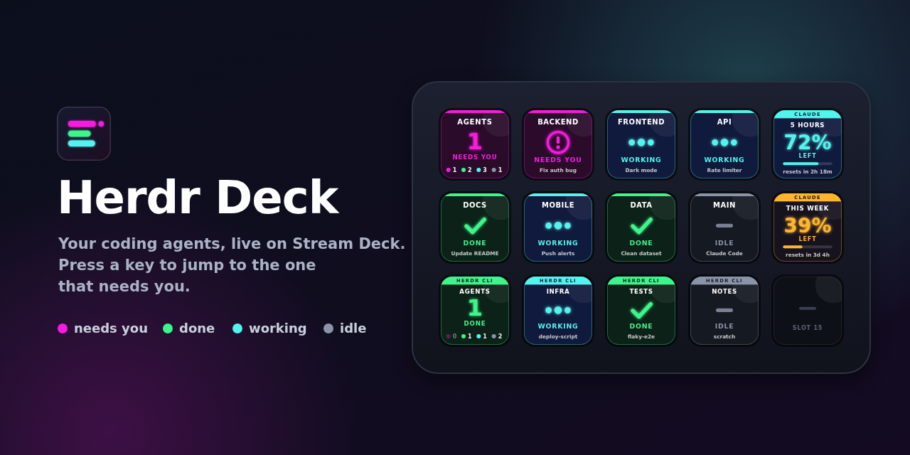
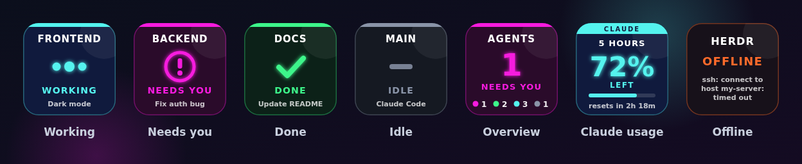
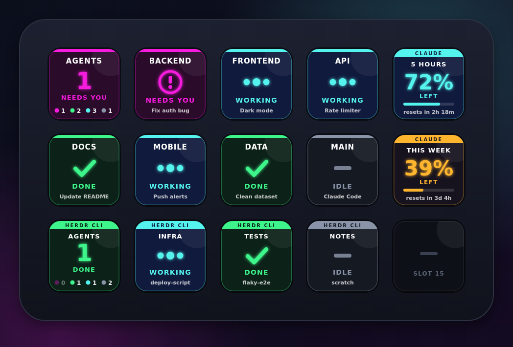

<p align="center">
  
</p>

<p align="center">
  <b>Your coding agents, live on Stream Deck.</b><br />
  See which Herdr agents are working, done or waiting for you, and jump to any of them with one press.
</p>

<p align="center">
  
  
  
  
</p>

<p align="center">
  <a href="#features">Features</a> ·
  <a href="#keys">Keys</a> ·
  <a href="#install">Install</a> ·
  <a href="#setup">Setup</a> ·
  <a href="#troubleshooting">Troubleshooting</a> ·
  <a href="#build-from-source">Build</a>
</p>

---

## Features

- **Live status, no polling.** Keys follow herdr-core's event stream and change the moment an agent does.
- **One press to jump.** Pressing a key focuses that agent in the Herdr app. The overview key goes straight to the agent that needs you.
- **Can't-miss alerts.** Agents that are blocked on you blink until you look.
- **Local or remote.** Read the agents on this computer, on a server over SSH, or both (duplicates are merged).
- **App and CLI.** Separate keys for the Herdr app and the terminal `herdr` CLI, so both are always on hand.
- **Claude plan usage.** An optional key shows how much of your Claude 5-hour or weekly limit is left.

<p align="center">
  
</p>

Status follows the Herdr app:

| State | Meaning |
| --- | --- |
| **Working** | The agent is busy. |
| **Needs you** | The agent is blocked on input. The key blinks. |
| **Done** | The agent finished while you weren't looking. |
| **Idle** | A done agent turns idle once you've looked at it in Herdr. |
| **Offline** | The connection dropped. The keys reconnect by themselves. |

## Keys

<p align="center">
  
</p>

| Action | Shows | Press |
| --- | --- | --- |
| **Herdr Overview** | The most urgent count (needs you > done > working), plus a row of counts | Jumps to the agent that needs you (or is done), else the next agent |
| **Herdr Agent** | One agent: space, status, title | Jumps to that agent |
| **Herdr CLI Overview** | The same, for the terminal `herdr` CLI ("HERDR CLI" band) | Jumps to the CLI agent that needs you |
| **Herdr CLI Agent** | One CLI agent: workspace, status, name | Focuses that pane, and brings forward the Herdr app terminal running the CLI |
| **Claude Usage** | % left of your Claude plan: 5 hours, this week, or whichever is lower | Refreshes now (it also updates every minute) |

Choose the agent a key shows with the **Agent** dropdown in its settings (↻ refreshes the list). Keys left on **Auto** fill in reading order with the agents no other key has picked. A picked agent that has ended shows **NOT RUNNING**.

## Install

**Requirements**

- Elgato Stream Deck software **7.1 or newer**, on **Windows 10+** or **macOS 13+**
- **Herdr** with herdr-core (`hc`) on the machine where your agents run, and the Herdr app (`herdr-app`) on this computer for jumping to agents
- For agents on another machine: an **OpenSSH client** (built into Windows 10+ and macOS) and key-based login to that machine
- Optional: the terminal `herdr` CLI for the CLI keys, and Claude Code for the Claude Usage key

**Steps**

1. Download `com.herdr-deck.streamDeckPlugin` from the [latest release](../../releases/latest).
2. Double-click it. Stream Deck installs the plugin and adds a **Herdr Deck** category.
3. Drag a **Herdr Overview** key and a few **Herdr Agent** keys onto your deck.

## Setup

Open any Herdr key's settings. The connection settings are shared by all Herdr keys.

### Agents on this computer

Nothing to set: the plugin reads the local herdr-core (`hc`). If `hc` isn't found, set its full path under **hc** in the key settings.

### Agents on another machine (SSH)

1. Make sure SSH works **without a password prompt** (the plugin uses `BatchMode=yes`, so it can't answer one). Run this once by hand; it also accepts the host key:

   ```sh
   ssh user@host "~/.local/bin/hc ls --json"
   ```

   If it asks for a password, set up a key: `ssh-keygen`, then add the `.pub` file to `~/.ssh/authorized_keys` on the server.

2. In the key settings, fill in:

   | Setting | Value |
   | --- | --- |
   | **SSH target** | `user@host` (an alias from `~/.ssh/config` works too) |
   | **Machine name** | The name the Herdr app uses for that machine (see `hc machine ls`). Defaults to the SSH host. |
   | **Remote hc** | Path to `hc` on the server, if it isn't `~/.local/bin/hc` |
   | **herdr-app** | Full path to `herdr-app` on this computer, if it isn't on PATH |

Any login shell works on the server (bash, zsh, fish, …).

### Claude Usage key

The Claude key has no login of its own. It reuses your [Claude Code](https://claude.com/claude-code) login, so run `claude` and then `/login` once.

- **Where it reads the login:** `~/.claude/.credentials.json` on this computer (on macOS, Claude Code's Keychain entry). If there's no valid login there, it reads the same file on the SSH target. You can change this under **Login from**.
- **What it sends:** the token goes only to `api.anthropic.com`, to the endpoint behind Claude Code's `/usage`. It is never stored or logged.

> [!NOTE]
> The usage endpoint isn't documented by Anthropic and may change. If the key stops working, check for a plugin update.

## Troubleshooting

| The key shows | What to do |
| --- | --- |
| `hc not found` / `herdr-app not found` | Set the full path in the key settings. |
| `ssh needs a key without password` | Set up key-based SSH login (see [Setup](#agents-on-another-machine-ssh)). |
| `run ssh once by hand…` | Run the `ssh` command above once to accept the server's host key. |
| `… not found on the server` | Set **Remote hc** (or **herdr CLI**) to the full path on the server. |
| **LOG IN** (Claude key) | Run `claude`, then `/login`, on this computer or the server. |
| A press does nothing | Check that **Machine name** matches `hc machine ls` in the Herdr app. |

Plugin logs are in the plugin folder under `logs/`:

- **Windows:** `%APPDATA%\Elgato\StreamDeck\Plugins\com.herdr-deck.sdPlugin\logs\`
- **macOS:** `~/Library/Application Support/com.elgato.StreamDeck/Plugins/com.herdr-deck.sdPlugin/logs/`

> [!TIP]
> The logs contain your SSH target and agent ids. Remove them before you paste a log into an issue.

## How it works

```text
Stream Deck plugin
  └─ hc events --json          locally, or over ssh: one live stream
       └─ herdr-core           every terminal, its agent status, space/tab, title
  └─ renderer                  an SVG tile per key
  └─ key press                 herdr-app do agent.focus --terminal <machine>/t3
```

`hc events --json` sends a full snapshot first and then one line per change. If the stream drops (sleep, network), the plugin reconnects with backoff. The CLI keys poll `herdr api snapshot` once a second and only redraw on changes. Each data source runs only while it has keys on the deck.

## Privacy

Herdr Deck talks only to your own machines (local commands and the SSH target you set) and, for the Claude key, to `api.anthropic.com`. It has no telemetry and makes no other network requests. The settings page is bundled with the plugin rather than loaded from the web. Settings stay in Stream Deck.

## Build from source

Requires Node.js 20+.

```bash
npm install
npm run build && npm test
npm run plugin:pack        # → dist/com.herdr-deck.streamDeckPlugin
```

Develop without a Stream Deck:

```bash
npm run helper:status                       # this computer's herdr-core, once, as JSON
npm run helper:watch -- --ssh user@host     # live agent list over SSH
npm run render:preview                      # sample tiles → packages/renderer/previews/
npm run render:live -- --ssh user@host      # your real tiles → docs/live/ (gitignored)
npm run render:showcase                     # README images → docs/images/, then scripts/png.sh
```

### Project layout

| Package | Role |
| --- | --- |
| `packages/shared` | Agent model: parses herdr-core and herdr CLI data, state rules, dedupe |
| `packages/helper` | Data sources (local and SSH), settings, Claude usage, a small CLI |
| `packages/renderer` | SVG tiles and the README images |
| `packages/streamdeck-plugin` | The Stream Deck plugin, settings pages and packaging |

## Acknowledgements

- Settings pages use [sdpi-components](https://sdpi-components.dev) (MIT), bundled in the plugin.
- Built on the [Stream Deck SDK](https://docs.elgato.com/sdk) (`@elgato/streamdeck`).

## License

[MIT](LICENSE)
